# Fleurdelys: a journey around the Riemann zeta function

*A follow-along account of an exploration in pictures, November 2026.*

This document walks through a personal exploration of the Riemann zeta function ζ(s), one picture at a time. It was done as a conversation between the author, who brought the questions and most of the patterns, and Claude, an AI model, who drew the pictures, checked the numbers, and looked up who had found each thing first.

**It is not a proof of the Riemann Hypothesis, and it does not claim to be.** It is closer to a field guide: here is an object, here is what it looks like from many angles, and here is what mathematicians already know about each feature we noticed. The author is working toward an observation of their own, which is not shared here yet; this journey is the groundwork for it.

You do not need to be a mathematician to follow along. Each stop has a picture, a short story, and a note on what is proven, what is open, and what is only something our code showed.

---

## How to read this

Every claim in this document carries one of three labels:

- **Proven:** a theorem, with the names of the people who proved it.
- **Open:** a conjecture or question nobody has settled.
- **Observed:** something our own code showed. It is a numerical observation, not a proof, even when the numbers look very convincing.

Most of what we noticed turned out to be known, sometimes for a century. We took that as good news: it means the pictures were showing real mathematics, not accidents of drawing.

## Contents

1. [Three ideas to start](#1-three-ideas-to-start)
2. [The flower](#2-the-flower)
3. [Newton's method and Mandelbrot sets inside ζ](#3-newtons-method-and-mandelbrot-sets-inside-ζ)
4. [What a proof would have to do](#4-what-a-proof-would-have-to-do)
5. [The petals hear the primes](#5-the-petals-hear-the-primes)
6. [Spirals, spectra and twin primes](#6-spirals-spectra-and-twin-primes)
7. [A detour through Collatz](#7-a-detour-through-collatz)
8. [Prime patterns and other flowers](#8-prime-patterns-and-other-flowers)
9. [Chaos, Fourier and a bouncing ball](#9-chaos-fourier-and-a-bouncing-ball)
10. [Putting the proof targets to the test](#10-putting-the-proof-targets-to-the-test)
11. [Eigenvalues: where the journey started](#11-eigenvalues-where-the-journey-started)
12. [Where this leaves us](#12-where-this-leaves-us)
13. [Appendix: scorecard, code and references](#13-appendix-scorecard-code-and-references)

---

## 1. Three ideas to start

**The zeta function.** For numbers s with real part bigger than 1, ζ(s) = 1 + 1/2ˢ + 1/3ˢ + 1/4ˢ + …. Euler noticed that the same function is a product over the primes: ζ(s) = ∏ₚ 1/(1 − p⁻ˢ). Riemann (1859) extended ζ to all complex s except s = 1, and found that its zeros control how the primes are spread out.

**The Riemann Hypothesis (RH).** Apart from some "trivial" zeros at −2, −4, −6, …, every zero of ζ should lie on one vertical line in the complex plane, the *critical line* Re s = ½. **Open** since 1859. Billions of zeros have been checked and all lie on the line.

**The look-alike.** Throughout the journey we compare ζ with a function found by Davenport and Heilbronn (1936). It obeys the same kind of symmetry as ζ and draws almost the same pictures, but it has zeros **off** the line. It has no product over the primes. It is the most useful tool in this whole document: any argument that would also "work" for the look-alike must be wrong, because for the look-alike the conclusion is false.

---

## 2. The flower

Walk up the critical line, s = ½ + it, and plot the value ζ(s) as a point in the plane. As t grows, the point traces a curve that loops around and around. The author calls it **the flower**; its loops are **petals**. The full four-dimensional object, the graph of ζ over the whole critical strip, is called **Fleurdelys**; the flower is the shadow of one slice of it.

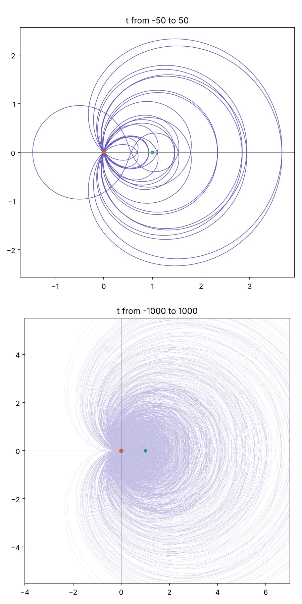

What the flower shows:

- **Every zero on the line is a petal through the origin.** (Proven, by definition: a zero is where the curve hits 0.) Up to height 50 there are 10 such petals; up to 1000 there are 649.
- **Petals are nearly circles.** On the line, ζ(½ + it) = Z(t)·e^(−iθ(t)), where Z is a real function (Hardy's Z-function) and θ a smooth angle (the Riemann–Siegel theta). The two leading terms trace a circle of radius 1 through the origin; the rest of the terms make it wobble. (Proven: approximate functional equation.)
- **The flower blooms faster as it climbs**, about (1/2π)·log(t/2π) petals per unit of height. Its total turning predicts the number of zeros up to height T, N(T) ≈ θ(T)/π + 1 (Riemann; von Mangoldt 1905, proven).
- **In flower language, RH says the flower never misses a petal.** Every half-turn that "should" make a petal through 0 does. (This equivalence is proven; RH itself is open.) A naive version, "one petal per half-turn, in order" (Gram's law), is false: it fails in about 16% of the intervals up to height 10,000 in our count (Observed; first failure found by Hutchinson in 1925).
- Off the line, the curve for ζ(σ + it) with σ ≠ ½ skims past 0 without touching, at every height we checked (Observed). That it never touches for ½ < σ < 1 is exactly RH (Open).

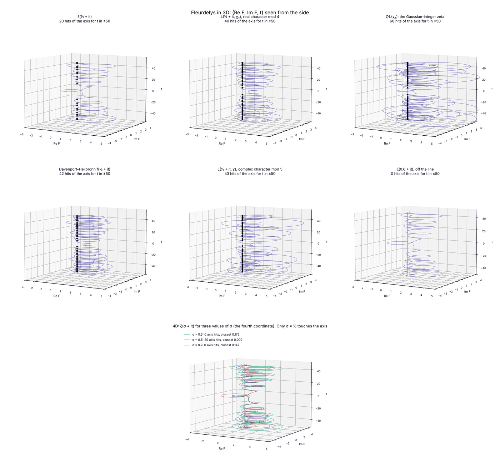

*Lifting the flower into 3D, with height t as the third axis, gives the "hourglass" the author first saw: a tube that pinches through the axis at every zero.*

---

## 3. Newton's method and Mandelbrot sets inside ζ

The author knows holomorphic dynamics, so an early question was: what happens if you run Newton's method on ζ? Newton's method is a rule for hunting zeros: start somewhere, slide along the tangent, repeat.

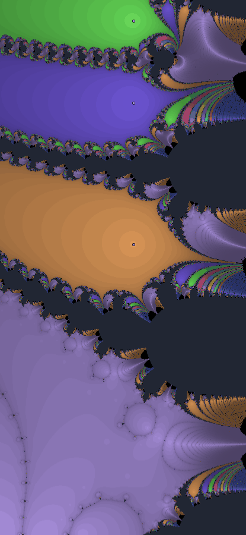

Color each starting point by which zero it ends up at, and the plane breaks into basins with fractal boundaries. Now add a parameter and solve ζ(s) = c instead. Plotting the behavior over all c gives a "parameter plane", and in it appear **small copies of the Mandelbrot set**.

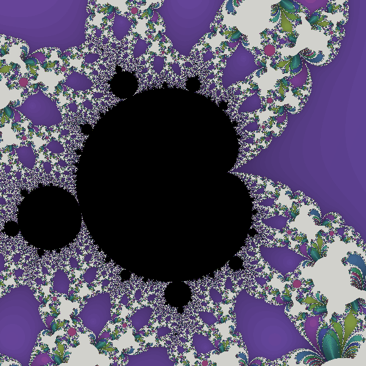

- The first copy sits near c ≈ −0.432 + 0.463i and is about 0.03 across (Observed). Ten copies of period 2 and over a hundred of period 3 turned up in one window.
- **This is expected.** Douady and Hubbard (1985) showed that maps which behave like z² + c in a small region carry copies of the Mandelbrot set. McMullen (2000) showed Mandelbrot copies appear in essentially every family of this kind (Proven). The flower itself crosses some of these copies, and at those parameters the "basilica" and "rabbit" Julia sets appear in the s-plane.

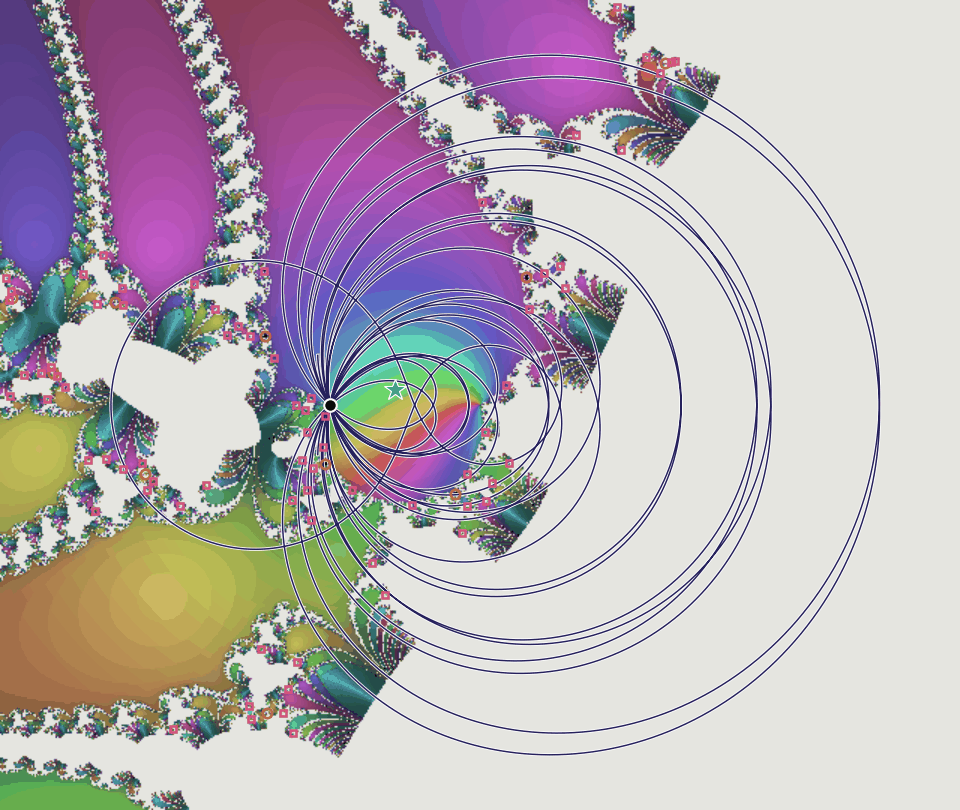

**Lesson.** Universality is beautiful, but it cuts both ways: because Mandelbrot copies appear in *every* such family, they cannot tell ζ apart from its look-alike. A proof cannot come from here alone.

---

## 4. What a proof would have to do

Inspired by the high-school students who found a new geometric proof of Pythagoras's theorem, we asked: what exactly would a geometric proof of RH have to show? We found four targets. Each is **proven to be equivalent** to RH, so proving any one of them for ζ would prove RH.

| Target | In flower language | Source |
| --- | --- | --- |
| A. Counting | Petals through 0 up to height T equal the total zero count N(T), for every T | Argument principle; checked numerically by Turing's method |
| B. Off-line slices | For every ½ < σ < 1 the curve t ↦ ζ(σ + it) never hits 0 | Definition of RH |
| C. No folds | ζ′ has no zeros in 0 < Re s < ½ | Speiser 1934; Levinson–Montgomery 1974 |
| D. The valley | Newton's method for the completed function ξ always steps toward the line | Lagarias 1999; Sondow–Dumitrescu 2010 |

Two further facts rule out the easiest kind of argument (both **Proven**): RH, if true, holds with no room to spare (Rodgers–Tao 2020), and off the line the curve comes arbitrarily close to 0 (Bohr). There is no "safe margin" to exploit.

Here is the look-alike next to ζ:

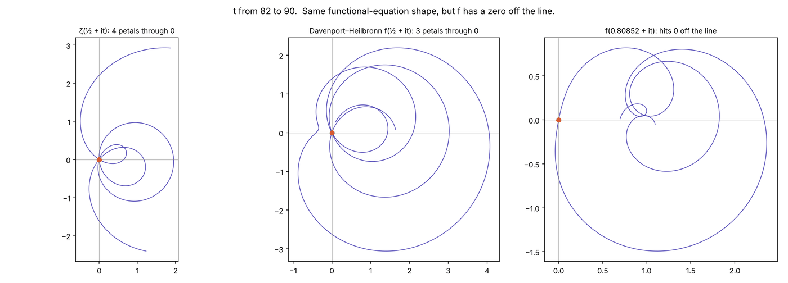

The two flowers look alike. But the look-alike has zeros at 0.80852 + 85.69935i and 0.65083 + 114.16334i, to the right of the line (Observed, checked to 25 digits; these zeros are well documented in the literature). Its flower simply skips those petals. Its Newton field breaks near them:

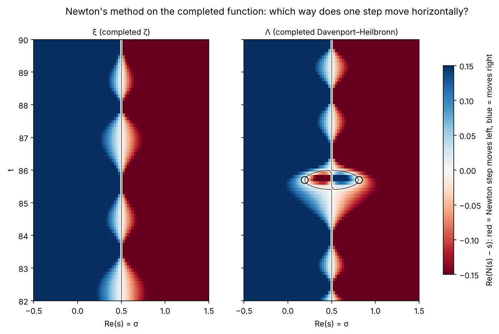

**The test we used from then on.** For any property P someone proposes:

1. ζ provably has P at all heights,
2. P implies one of the targets A–D, and
3. the Davenport–Heilbronn function does *not* have P.

Condition 3 matters most. Anything built only from the symmetry, petal shapes, growth or Newton/Mandelbrot dynamics also "proves" a falsehood about the look-alike. A real proof must use **the primes**, through the Euler product ζ(s) = ∏ₚ 1/(1 − p⁻ˢ), somewhere.

---

## 5. The petals hear the primes

If a proof must use the primes, where do the primes show up in the flower? Answer: in the *heights* of the petals.

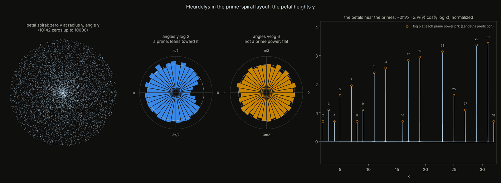

Take each zero's height γ and look at the angle γ·log x. When x is a prime or a prime power, these angles lean toward π; for other x they do not. For x = 2 the average of e^(iγ log 2) is −0.0768 against a predicted −0.0769; for x = 6 and 10 it is 0 (Observed). This is a theorem of Landau (1912), and the cleanest form of it is Riemann's **explicit formula**: the zeros and the prime powers are Fourier partners (Proven).

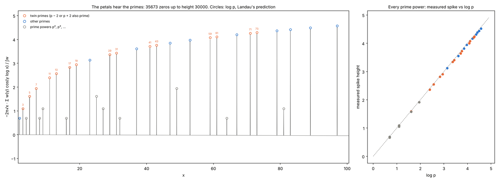

Using 35,673 zeros up to height 30,000, a spike of height log p appears at every prime power up to 100. All 35 are within 0.075 of log p, and every other number stays below 0.042 (Observed). Twin primes get no special spike: the zeros hear each prime separately.

The look-alike has no Euler product, so it should not show these clean spikes. We expect that but have not drawn it yet (Open, in our code).

---

## 6. Spirals, spectra and twin primes

The author had been watching videos about why primes form spirals when you plot n at radius n and angle n radians. We tried that layout for primes, twin primes and the petals.

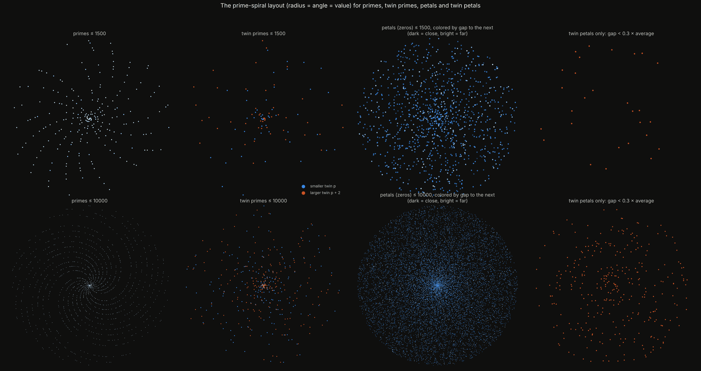

- **The arms come from the layout, not the primes.** 2π is close to 44/7 and 710/113, so points 44 or 710 apart line up. Primes avoid even arms and multiples of 11, which is Dirichlet's theorem on primes in progressions (Proven). Twin primes take their own arms.
- **The petals show no arms** (Observed). Hlawka (1975) proved the zeros' heights are spread evenly in this kind of picture (Proven).

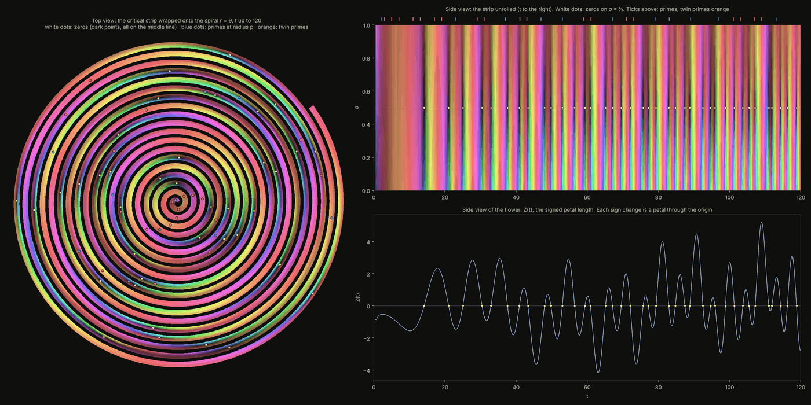

Because the author works with Fourier transforms, we treated the zeros as a signal.

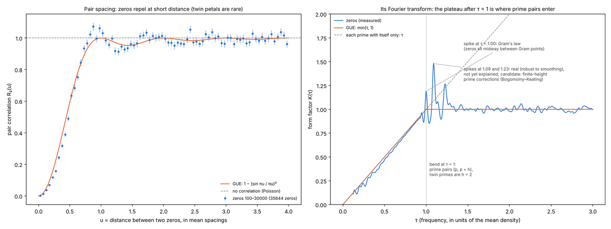

- **The zeros repel each other** like the eigenvalues of large random matrices. Only 0.6% of gaps are below a fifth of the average, against 18.1% for random points (Observed). This is Montgomery's pair correlation (1973), matched to random-matrix theory with Dyson, and confirmed numerically on a huge scale by Odlyzko. Fully proving it is still **Open**.
- The Fourier transform of the pair correlation (the "form factor") rises and then stays flat at 1.000 ± 0.021 (Observed), as Montgomery predicted. Small spikes at 1.09 and 1.23 in our data are real but **unexplained** so far.
- A spectrogram of Z(t) shows one chirp for every whole number n (Observed; it follows from the Riemann–Siegel formula).

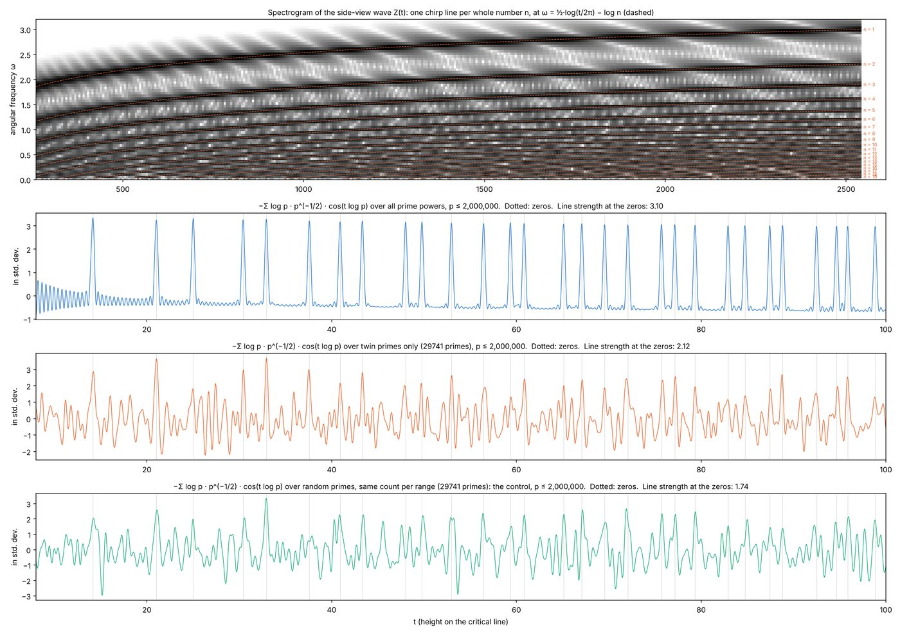

---

## 7. A detour through Collatz

Partway through, the author wanted to play with a different famous problem. The **Collatz conjecture** says: start with any positive whole number; halve it if even, otherwise triple it and add 1; you always reach 1 (**Open**).

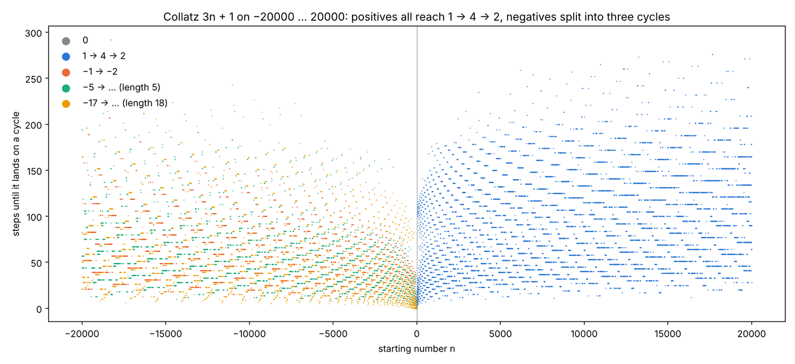

- **Negative numbers behave differently.** Down to −1,000,000, every start ends in one of three cycles: (−1, −2), (−5, −14, −7, −20, −10), and an 18-step cycle through −17 (Observed). Each takes about a third of the starts.
- **There is a smooth version.** f(z) = (2 + 7z − (2 + 5z)·cos πz)/4 agrees with Collatz on whole numbers and works for complex z (Letherman, Schleicher and Wood 1999). A cycle with k odd and m even steps has "multiplier" 3ᵏ/2ᵐ, so positive cycles attract and negative ones repel (Proven, one line).
- **The author spotted a Julia set** hiding next to −1. Our check matches it to the filled Julia set of z² + 0.187 on 99.4% of pixels (Observed). This is the same Douady–Hubbard mechanism as the Mandelbrot copies in Section 3. Next to the cycles at −5 and −17 hide copies of degree 8 and 2048.

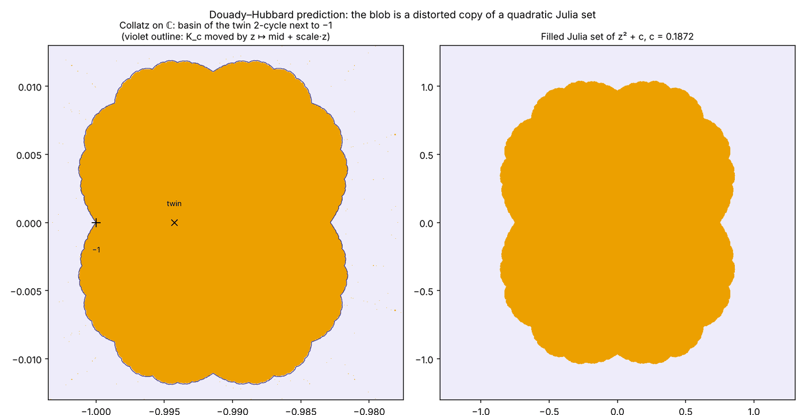

**The parallel with RH.** The negative numbers follow the same rule but have extra cycles. So a proof for the positive numbers must use something that fails for the negatives: the Collatz version of the look-alike test.

---

## 8. Prime patterns and other flowers

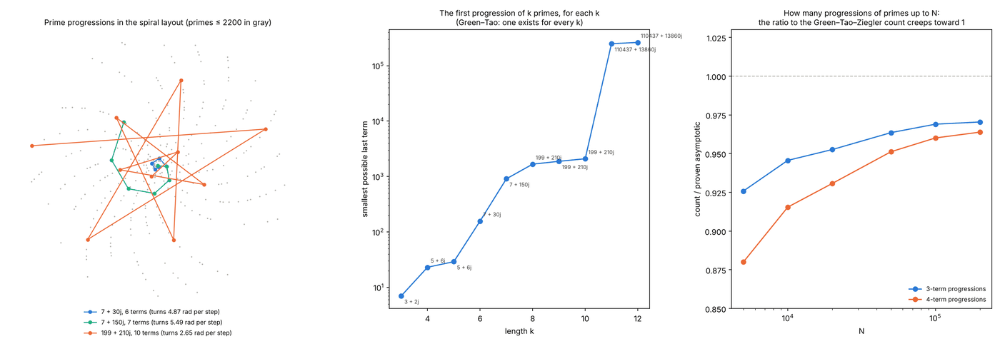

- **Green–Tao (2008):** the primes contain arithmetic progressions of every length (Proven). We found the first ones of lengths 3 to 12. Our counts match the predicted formula to within 3–4% (ratios 0.970 and 0.964; Observed).
- **The star.** The author noticed that the progression 199 + 210j looks like a single orbit of the Mandelbrot map. The reason is shared geometry: both turn by a fixed angle each step (0.4225 against 0.4226 turns; Observed). That is a fact about rotations, not about primes.
- **Sunflowers.** Vogel's sunflower model (1979), with the golden angle, 1 radian, or the step 210, gives arm counts from continued fractions: Fibonacci numbers, or 6, 44, 710 (Proven: properties of rotations).

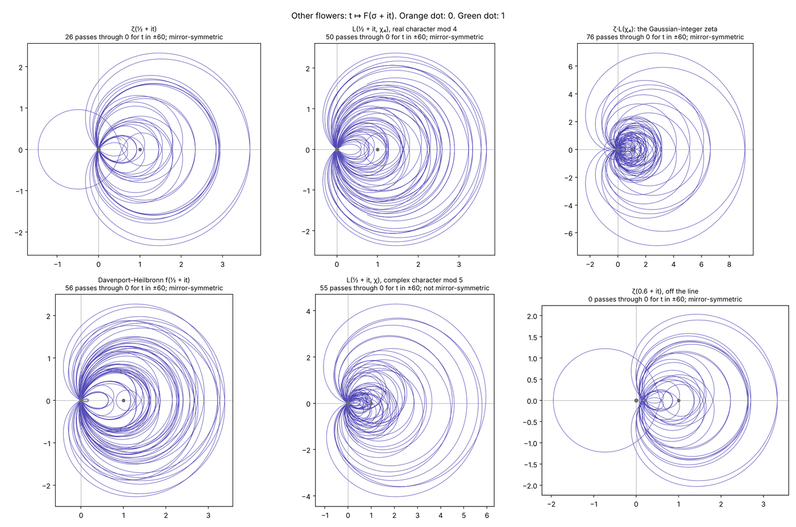

The "hourglass" flower is not special to ζ. Every L-function with real coefficients draws it, and so does the look-alike (Observed). A function with complex coefficients breaks the mirror symmetry.

**Twin primes.** Are there infinitely many primes p with p + 2 also prime? (**Open**.) Saying "a circle of radius K contains every twin prime" is the same as saying the conjecture is false: it is a restatement, not progress. The count up to 10⁸ is 440,312 pairs, matching the Hardy–Littlewood prediction to a ratio of 0.9999 (Observed).

---

## 9. Chaos, Fourier and a bouncing ball

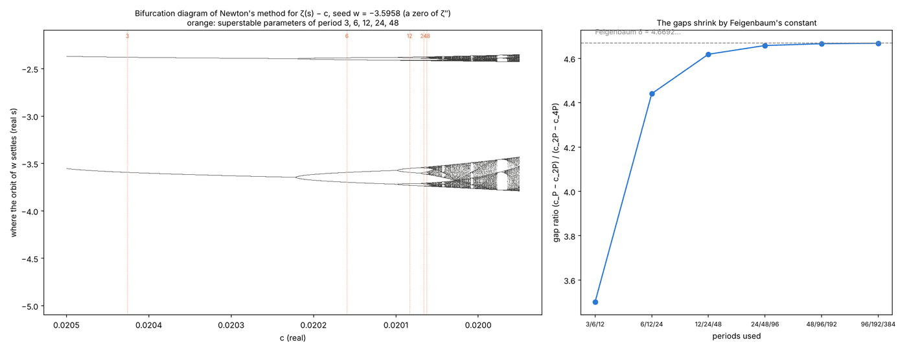

- **Feigenbaum's constant inside ζ.** Along the real line, ζ's Newton family goes through a period-doubling cascade. The ratios of successive gaps approach 4.6686, heading for Feigenbaum's δ = 4.6692 (Observed; universality proven by Lanford and others).
- **Fourier spectra.** The primes have spectral lines at fractions a/q with heights 1/φ(q); twin primes have lines at the same places with Hardy–Littlewood heights; Collatz step counts have lines only at a/2ᵐ (Observed; consistent with known theory).
- **The bouncing ball.** The author compared |Z(t)| to a ball bouncing off the floor at each zero. The "elasticity" (ratio of successive bounce heights) has median 0.990 (Observed). The sizes of log|ζ| follow Selberg's law (1946) with the Keating–Snaith correction (2000). In a related toy, two blocks colliding with mass ratio 100ᵏ bounce 3, 31, 314, 3141, … times: the digits of π (Galperin 2003).

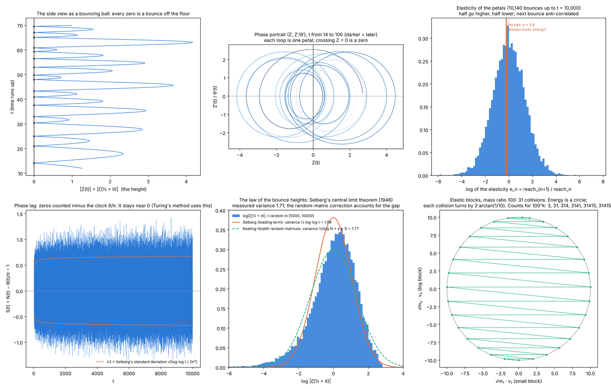

- **Chaos.** The Mandelbrot escape rule has a ζ analogue: for Re s > 1 the Euler product keeps |ζ| at least ζ(2σ)/ζ(σ), away from 0 (Proven). The hard problems live where no single term dominates. RH has a known chaos-style equivalent: ζ approximately repeats itself in a strong sense if and only if RH holds (Bagchi 1981, Proven).

---

## 10. Putting the proof targets to the test

With the targets and the look-alike in hand, we built three tools that apply them directly to ζ, a well-behaved relative L(s, χ₄) (which has an Euler product), and the look-alike.

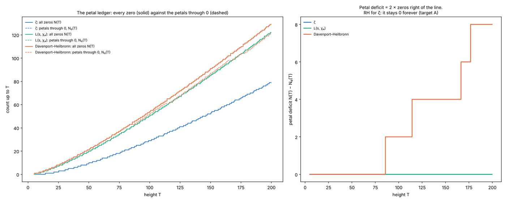

**The petal ledger (target A).** Count every zero up to height T by the argument principle, and count the petals through 0. For ζ and L(s, χ₄) the two counts agree at every height up to 200. For the look-alike, the gap jumps by 2 at heights 85.8, 114.2, 166.5 and 176.8, exactly at its four off-line zeros (Observed).

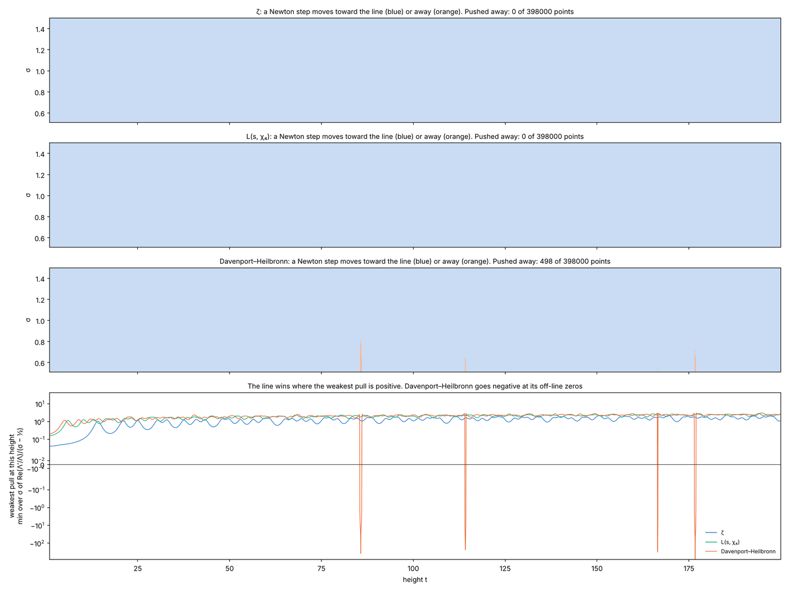

**The pull of the line (target D).** On a grid of 398,000 points right of the line, every Newton step for ζ and L(s, χ₄) moves toward the line. For the look-alike, 498 points are pushed away, in four pockets at its off-line zeros (Observed).

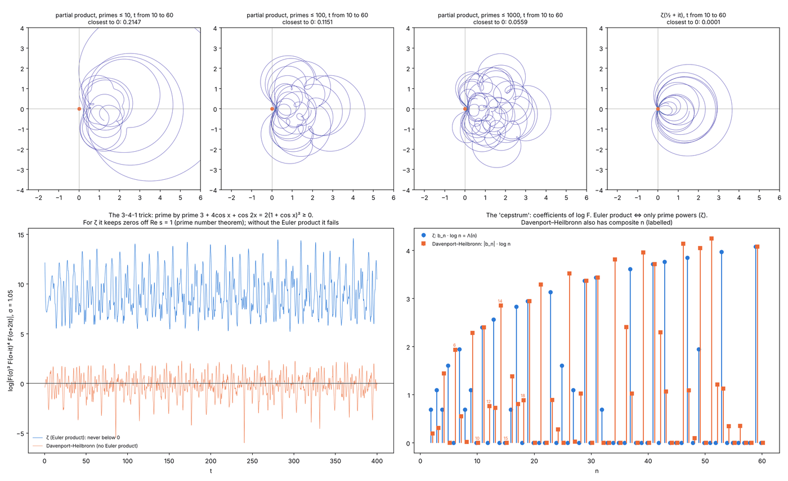

**The Euler product, the special part.**

- Partial products over the primes never reach 0, so the zeros appear only in the limit (Proven, since each factor is nonzero).
- The classical "3-4-1" trick uses 3 + 4cos x + cos 2x = 2(1 + cos x)² ≥ 0, prime by prime, to keep zeros off the line Re s = 1. That gives the prime number theorem (Hadamard and de la Vallée Poussin 1896, Proven). For ζ the quantity stays above +5.21 at σ = 1.05; for the look-alike it drops to −5.98 (Observed).
- The log of ζ has coefficients only at prime powers. The look-alike's spill onto composite numbers.

This is the model of a geometric argument that works: a positivity, applied prime by prime.

---

## 11. Eigenvalues: where the journey started

The author's interest in mathematics began with the eigenvalues and eigenvectors of simple matrices, so the last part of the journey went back there.

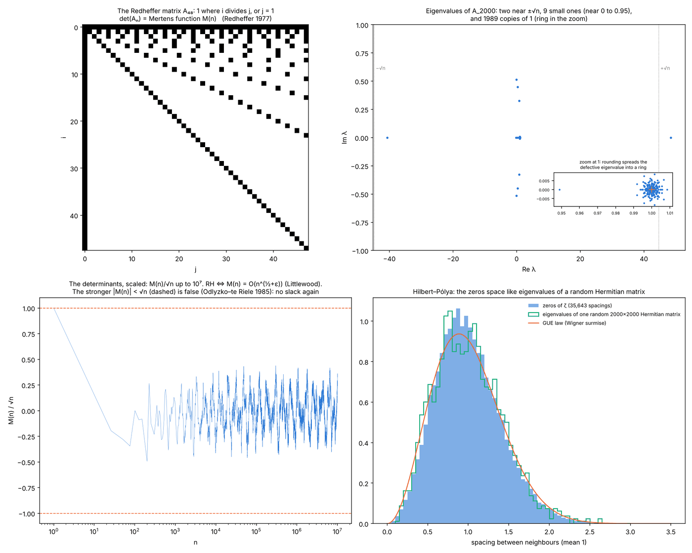

**The Redheffer matrix** is a simple 0/1 table: 1 where i divides j, or j = 1. Its determinant is the Mertens function, a running sum over the primes (Redheffer 1977, Proven). RH is equivalent to this sum growing no faster than about √n (Littlewood 1912, Proven). From n = 100 up to 10⁷ it stays below 0.568·√n (Observed; for small n the ratio is larger, 0.89 at n = 5). The stronger guess "always below √n" is false (Odlyzko and te Riele 1985, Proven), which is again "no slack".

**Hilbert–Pólya, or the flower turned into a circle.** The author imagined "another flower" that forces the zeros onto the line. The map w = 1 − 1/s turns the critical line into the unit circle, so RH says every zero lands *on* the circle. That is Li's criterion (Li 1997; Bombieri–Lagarias 1999, Proven equivalence).

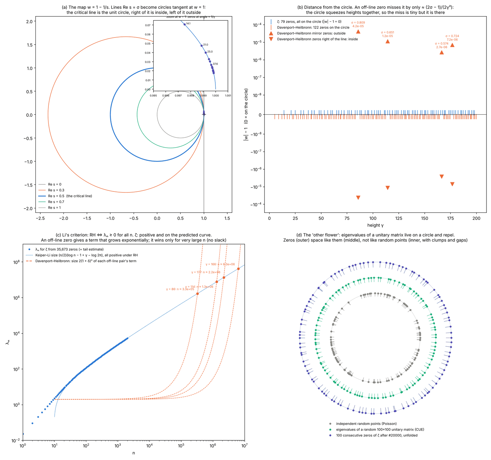

- ζ's first Li coefficient from our zeros, λ₁ = 0.0230957, matches the exact value (Observed).
- The look-alike's off-line zeros miss the circle by only 3·10⁻⁶ to 4·10⁻⁵ (Observed): tiny, but enough.
- The old Hilbert–Pólya hope: the zeros are the eigenvalues of some symmetric (self-adjoint) operator, which would force them onto the line. No such operator is known (**Open**). Building a matrix from the known zeros is trivial; the challenge is to build one from the primes.

**The Collatz cycle matrix.** The author brought in their own eigenspace pictures of the Collatz cycles at −17 and 1 (kept in [`cycle_kernels/`](cycle_kernels/)). Their matrix B moves a small nudge from one cycle point to the next.

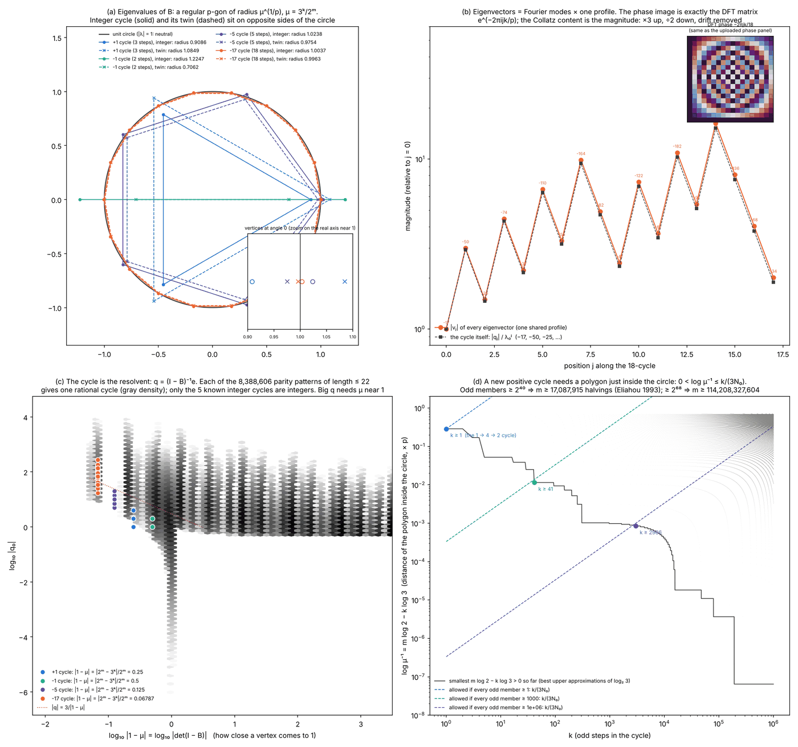

- **Eigenvalues: a regular polygon** of radius (3ᵏ/2ᵐ)^(1/p). It can never sit exactly on the unit circle, because 3ᵏ is never equal to 2ᵐ (Proven, short algebra).
- **Eigenvectors: Fourier modes** times one profile, and the profile is the cycle itself (Proven; the author's phase picture is exactly the discrete Fourier matrix).
- **The cycle is solved by the matrix:** the cycle equals (I − B)⁻¹ applied to the pattern of odd steps. This is the classical cycle equation (Böhm and Sontacchi 1978). Searching all 8.4 million step patterns up to length 22 finds exactly the 5 known integer cycles (Observed).
- **A new positive cycle would have to hug the unit circle from inside**, which requires 3ᵏ and 2ᵐ to be extremely close. That reasoning gives the known lower bound on cycle length: our computation reproduces Eliahou's 17,087,915 (1993) exactly.

**Back to RH: zeta functions as determinants.** The cycle matrix gives det(I − zB) = 1 − μzᵖ, which has exactly the shape of one factor 1 − p⁻ˢ of the Euler product. Multiplying such factors over all cycles of a system gives a "zeta function" for that system (Artin–Mazur 1965; Ruelle 1976).

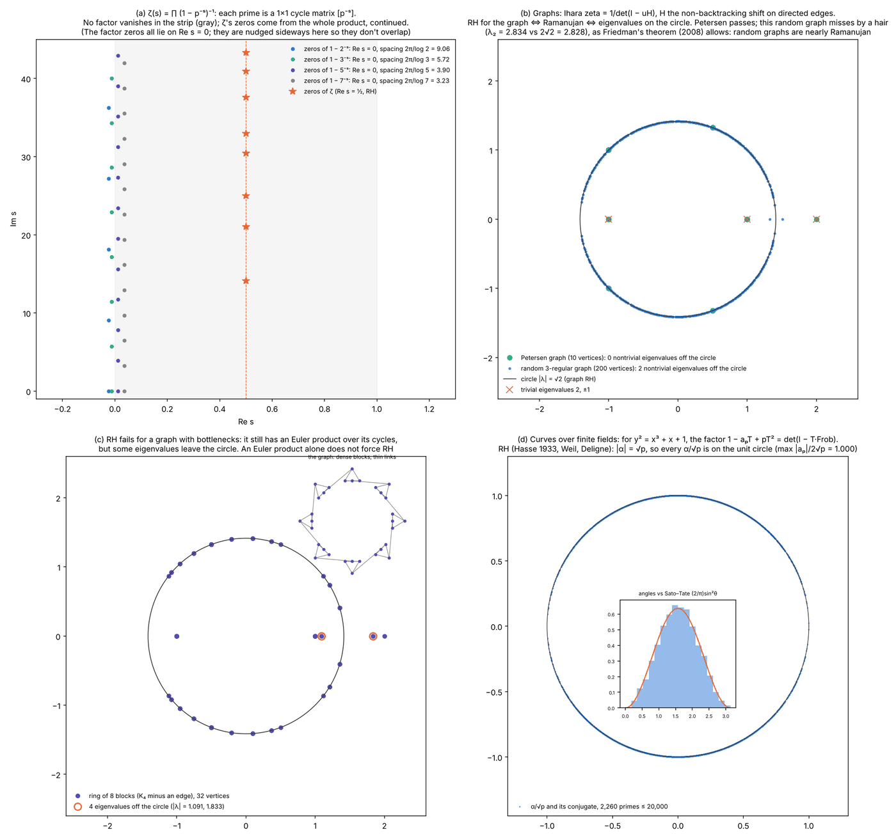

In the settings where an RH-type statement is a **theorem**, it says: *the eigenvalues of a matrix built from cycles lie on a circle.*

- **Graphs.** RH for a graph's zeta function holds exactly when the graph is "Ramanujan" (Ihara 1966; Lubotzky–Phillips–Sarnak 1988, Proven). The Petersen graph passes; a random graph nearly passes (Observed).
- **Curves over finite fields.** RH is proven there (Hasse 1933; Weil 1948; Deligne 1974). For the curve y² = x³ + x + 1 we checked all 2,260 primes up to 20,000: every eigenvalue is on the circle, spread in the Sato–Tate pattern (Observed; Sato–Tate proven 2008–2011).
- **A graph with bottlenecks** still has an Euler product, but its eigenvalues leave the circle (Observed). **An Euler product alone does not force RH.**

---

## 12. Where this leaves us

**What the journey taught us.**

1. **The eye finds real mathematics.** Almost every pattern the author spotted was a known theorem seen in a new picture: Landau's formula in the spiral, Douady–Hubbard in the Collatz Julia set, Montgomery's repulsion in the spacing, Eliahou's bound in the polygon. That is encouraging. It means the pictures are faithful.
2. **Three mechanisms keep coming back.**
   - *Rotation by a fixed angle* (continued fractions): the spiral arms, the sunflowers, the star shape, log₂ 3 in Collatz.
   - *Fourier duality between zeros and primes*: the petal spectrum, the explicit formula, the spectroscopy.
   - *Universality*: Mandelbrot copies, Julia sets, Feigenbaum's constant, random-matrix spacing. These appear everywhere, which is exactly why they cannot tell ζ from its look-alike.
3. **Two look-alike tests point the same way.** The Davenport–Heilbronn function has ζ's symmetry but no Euler product, and RH fails for it. The bottleneck graph has an Euler product but no extra structure, and RH fails for it. So a proof for ζ needs **both** the primes **and** a positivity or spectral reason that forces the zeros onto the line. For curves over finite fields that reason is Weil's positivity; for ζ nobody has found it (Connes's program is one attempt, **Open**).
4. **There is no slack.** Rodgers–Tao, Bohr, Li's criterion and the Mertens function all say the same thing: if RH is true, it holds with no room to spare. Any argument must be exact.

**What is still open in this project.** Explaining the small spikes at 1.09 and 1.23 in the pair correlation; drawing the look-alike's prime spectrum; a few literature checks (listed in [`CLAUDE.md`](CLAUDE.md)); and, most of all, **the author's own observation about the flower**, which is the destination of this journey and has not been shared yet. When it is, it will go through the same checklist ([`Observation checklist.md`](Observation%20checklist.md)): state it in one sentence, check it is not a known equivalent in disguise, and run the look-alike test.

---

## 13. Appendix: scorecard, code and references

### Scorecard

| Claim | Status |
| --- | --- |
| Riemann Hypothesis | Open |
| Targets A–D are each equivalent to RH | Proven |
| RH holds with no slack (Λ = 0 if RH) | Proven (Rodgers–Tao) |
| Zeros on the line hear the primes (Landau, explicit formula) | Proven |
| Zero spacings follow random-matrix statistics | Open in full; strongly supported (Montgomery, Odlyzko) |
| Mandelbrot copies in parameter families | Proven (Douady–Hubbard, McMullen) |
| The look-alike has zeros off the line | Observed here to 25 digits; well documented in the literature |
| Petal ledger, pull of the line, 3-4-1 checks in this repository | Observed |
| Collatz conjecture | Open |
| Collatz cycle-length bound 17,087,915 | Proven (Eliahou), reproduced here |
| Twin prime conjecture | Open |
| RH for graphs ⇔ Ramanujan; RH for curves over finite fields | Proven |
| An operator whose eigenvalues are ζ's zeros | Open (Hilbert–Pólya) |

### Running the code

```bash
pip install -r requirements.txt
python flower.py                 # the flower
python zeta_determinants.py      # the last picture in this document
python make_gallery.py           # rebuild images/ after running the scripts
```

Every picture names its script in the [gallery](images/README.md). Full-size versions are drawn into `output/`. The complete log with every number and every correction is in [`Fleurdelys notes on the zeta flower.md`](Fleurdelys%20notes%20on%20the%20zeta%20flower.md).

### References (by topic)

- **ζ and its zeros:** Riemann 1859; von Mangoldt 1905; Hardy 1914; Hutchinson 1925; Turing 1953; Odlyzko (numerical studies from 1987).
- **Proof targets:** Speiser 1934; Levinson–Montgomery 1974; Lagarias 1999; Sondow–Dumitrescu 2010; Rodgers–Tao 2020; Bohr; Voronin 1975; Bagchi 1981.
- **The look-alike:** Davenport–Heilbronn 1936.
- **Primes in the zeros:** Landau 1912; Hlawka 1975; Montgomery 1973; Keating–Snaith 2000; Selberg 1946.
- **Dynamics:** Douady–Hubbard 1985; McMullen 2000; Feigenbaum 1978; Galperin 2003.
- **Prime patterns:** Hardy–Littlewood 1923; Green–Tao 2008; Vogel 1979.
- **Collatz:** Terras 1976; Steiner 1977; Böhm–Sontacchi 1978; Lagarias 1990; Eliahou 1993; Letherman–Schleicher–Wood 1999.
- **Eigenvalues and determinants:** Littlewood 1912; Redheffer 1977; Odlyzko–te Riele 1985; Li 1997; Bombieri–Lagarias 1999; Berry–Keating 1999; Connes 1999; Artin–Mazur 1965; Ruelle 1976; Ihara 1966; Hashimoto 1989; Bass 1992; Lubotzky–Phillips–Sarnak 1988; Friedman 2008; Hasse 1933; Weil 1948; Deligne 1974.

*Written November 2026. The pictures and numbers come from the scripts in this repository; the history of each idea comes from the published literature named above.*
